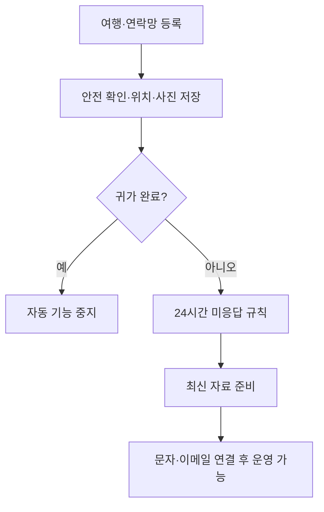
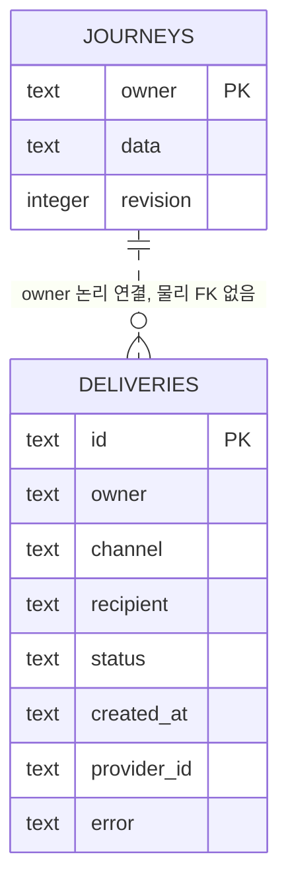

# 여행안심 · 여행 경로와 안전 연락망

소스: V1.4 준비 / 운영 사이트: V1.3

여행 일정과 가족·친구 연락처를 등록하고, 여행 중 위치를 저장하며 안전 확인이 끊긴 경우 전달할 자료를 준비하는 휴대전화 중심 웹 서비스입니다.

서비스: https://travel-safety-circle.leafytiger512.chatgpt.site

노션 설계·운영 문서: https://app.notion.com/p/3ff28cb9cfd781c08dfbe3fc7caeca62

> **운영 상태:** 여행 등록·연락처·사진·위치 저장·신고 참고자료 기능은 구현했습니다. 문자·이메일 발송 어댑터는 구현했지만 발송 계정과 무인 정기감시는 연결되지 않았습니다. 현재 24시간이 지나도 자동 발송되지 않습니다. 경찰·대사관 자동 신고 기능도 없습니다.

## 목차
1. 프로젝트 소개
2. 기능정의서
3. 화면구성도
4. DB 설계와 ERD
5. 데이터 수집 방법
6. 개발 환경
7. 실행 방법
8. 테스트 항목

상세 문서: [기획·기능정의](docs/01_기획_기능정의.md) · [화면설계](docs/02_화면설계.md) · [DB·ERD·PK·FK](docs/03_DB_ERD.md) · [데이터 출처·개발환경](docs/04_데이터출처_개발환경.md) · [실행·검증](docs/05_실행_검증.md) · [개발 프롬프트](docs/06_개발프롬프트.md) · [변경이력](docs/CHANGELOG.md)

## 1. 프로젝트 소개

| 항목 | 내용 |
|---|---|
| 주제 | 여행안심: 여행 경로·위치·안전 확인·비상연락망 관리 |
| 주요 사용자 | 국내·해외 여행자, 등록 동의를 받은 가족·친구 |
| 문제 | 여행자가 연락되지 않을 때 일정·마지막 위치·사진·연락처가 흩어져 있음 |
| 제공 가치 | 사용자가 등록한 자료를 계정별로 보관하고 안전 확인 필요 알림용 자료로 정리 |
| 데이터 출처 | 본인 입력, 허용한 휴대전화 GPS, 선택·촬영한 사진, 직접 확인한 기관 연락처 |
| 자료 형태 | 화면, 텍스트 공유, 인쇄/PDF, 자동 이메일용 JSON·사진 첨부 코드 |
| 검토 원칙 | 미응답을 실종으로 단정하지 않음. 계획 경로와 실제 저장 위치, 업체 접수와 수신 완료를 구분 |
| 샘플 제외 | 가상 여행·가족 연락처·운영용 샘플 데이터 자동 삽입 없음. 테스트 자료는 테스트 코드에서만 사용 |
| 기본 제한 | 현재 여행 1건, 연락처 최대 10명, 최근 이벤트 100개, 사진 2종 각 5MB |

기존 UI·상태·저장 후 메인 복귀 흐름을 유지합니다. 지침서의 예시 업종·뉴스 생성·특정 기술명은 이 프로젝트의 필수 기능으로 가져오지 않습니다. 이 서비스는 LLM 기사 생성기가 아니며 현재 OpenAI API를 호출하지 않습니다. 독립 프로젝트와 계정별 자료 분리를 유지하고, 선택형 AI 요약·번역 코드와 화면을 구현했습니다. 키는 사용자가 나중에 설정하며 현재 실호출·V1.4 배포는 하지 않았습니다. [OpenAI 연동 구현](docs/09_OpenAI_연동구현.md)을 참고하세요.

## 2. 기능정의서

| ID | 기능명 | 입력 → 출력 | 현재 상태 |
|---|---|---|---|
| F01 | 로그인·개인자료 분리 | Sites 로그인 → 본인 계정의 자료 | 구현 |
| F02 | 여행 등록·수정 | 여행자·행선지·기간·숙소·교통·경로 → 저장 후 홈 | 구현 |
| F03 | 가족·친구 등록 | 이름·전화번호·이메일·수신동의 필수 → 연락망 | 구현 |
| F04 | 연락처 수정·삭제 | 연락처 ID → 본인 연락처 갱신 | 구현 |
| F05 | 안전 확인 | 본인 확인·다음 확인시간 → 안전 확인 시각 기록 | 구현 |
| F06 | 현재 위치 지도 | 위치 권한·GPS → 좌표·오차·확인시각 | 구현, 실기기 검증 필요 |
| F07 | 여행 중 2시간 저장 | 최초 GPS·직전 자동 저장시각 → 2시간 경과 시 저장 | 규칙 검사 통과; 웹 종료 중 보장 안 됨 |
| F08 | 사진 업로드 | 선택·촬영 JPEG/PNG/WebP → 여행자/지역 사진 | 구현, 실기기 촬영 미검증 |
| F09 | 신고 참고자료 | 최신 서버자료·위치·사진 → 텍스트·인쇄/PDF | 구현, 실제 휴대전화 PDF 미검증 |
| F10 | 24시간 미응답 판단 | 마지막 안전 확인·여행 시작 → 안전 확인 필요 대상 | 규칙 검사 통과 |
| F11 | 문자·이메일 요청 | 동의한 가족·친구 → LMS·이메일 발송 API | 어댑터 구현; 실제 발송 미연결 |
| F12 | 귀가 완료 | 완료 선택 → 자동 알림 요청·자동 위치 중지 | 구현 |
| F13 | QR 접속 | QR 스캔 → 사이트·본인 로그인 | QR 생성; 단말 스캔 미검증 |
| F14 | 기관 연락 | 사용자가 확인한 기관 번호 → 전화 앱 연결 | 구현, 자동 신고 아님 |
| F16 | AI 정리·번역 | 본인 여행자료·전송 동의 → 한국어/영어/일본어 초안 | 코드 구현; 키는 추후 입력, 실호출 미검증 |
| F15 | 발송 기록 | API 응답 → 업체 접수·거절·확인 필요 | 코드 구현; 실발송 미검증 |

### 시간 규칙

- 위치: 등록한 여행 기간(한국시간 출발일 00:00부터 귀가일 종료까지) 중 첫 자동 위치를 저장한 뒤, 마지막 자동 저장에서 2시간이 지났을 때 다시 저장합니다.
- 화면이 열린 동안 약 1분마다 저장시각 도래 여부를 확인합니다. GPS·인터넷·브라우저 상태에 따라 실제 저장이 늦어질 수 있습니다.
- 새로고침해도 서버의 `lastAutoLocationAt`을 사용합니다. 수동 저장은 자동 간격을 바꾸지 않습니다.
- 24시간: 여행 시작과 마지막 안전 확인 중 늦은 시각을 기준으로 판단합니다. 위치 저장만으로 안전 확인 시간이 갱신되지 않습니다.
- 귀가 완료 후 자동 알림을 끄며, 자동 위치도 중지합니다. 미응답은 실종 확정이 아닙니다.

## 3. 화면구성도

| 화면 | 주요 요소 | 완료 후 이동 |
|---|---|---|
| 홈 | 여행 카드, 안전 확인, 현재 위치, 마지막/다음 위치 저장, 24시간 기준, 최근 기록 | 홈 유지 |
| 여행 일정 | 이름·연락처·기간·숙소·교통·계획 경로·기관 번호 | 등록/수정 저장 후 홈 |
| 연락망 | 이름·전화·이메일 필수 입력, 관계, 동의, 수정·삭제·직접 연락 | 저장 후 홈 |
| 신고자료 | 사진 선택/촬영 즉시 업로드, 최신정보·위치·사진 시각, 텍스트·인쇄/PDF | 해당 화면 |
| 팝업 | 여행 등록, 연락처, 안전 확인, SOS, 귀가 완료, QR, 도움말 | 처리 후 홈 또는 연락망 |

휴대전화 하단 메뉴: 홈 / 여행 일정 / 연락망 / 신고자료. SOS는 기록 후 직접 연락할 수 있는 연락망 화면으로 이동합니다. 사진이 포함된 수동 전달은 인쇄/PDF 저장 후 파일 공유를 사용합니다. 일반 공유 버튼은 텍스트만 전달합니다.



## 4. DB 설계와 ERD

실제 DB는 SQLite 호환 Cloudflare D1입니다. MySQL·PostgreSQL·FastAPI로 이관한 버전이 아닙니다.

| 테이블 | 컬럼·타입 | 키·제약 | 용도 |
|---|---|---|---|
| journeys | owner TEXT | PK, NOT NULL | 외부 인증에서 받은 사이트별 사용자 ID |
| journeys | data TEXT | NOT NULL | 여행·연락처·위치·상태를 JSON으로 저장 |
| journeys | revision INTEGER | NOT NULL, 기본 0 | 동시 저장 충돌 감지 |
| deliveries | id TEXT | PK, NOT NULL | 계정·안전확인시각·채널·수신자 해시 중복 방지 |
| deliveries | owner TEXT | NOT NULL, 물리 FK 없음 | 계정별 발송 기록 조회 |
| deliveries | channel, recipient, status TEXT | NOT NULL | 문자/이메일, 수신자, 요청 상태 |
| deliveries | created_at TEXT | NOT NULL | 기록 생성시각 |
| deliveries | provider_id, error TEXT | NULL 가능 | 업체 요청 ID, 오류 안내 |



`data` 내부 항목: `trip`, `contacts[]`, `events[]`, `location`, `status`, `lastCheck`, `lastAutoLocationAt`, `alertsEnabled`, `dataUpdatedAt`. 연락처 배열의 `id`는 논리 식별자이며 SQL의 PK/FK가 아닙니다. 이름·전화·이메일·동의·중복은 서버에서 검사합니다. 현 스키마에 물리 FK·JSON 내부 NOT NULL·CHECK가 있다고 표현하지 않습니다.

사진은 R2에 `photos/{사용자ID의 SHA-256}/{person|area}` 형태로 저장하며 최신 파일로 교체합니다. 사진은 별도 SQL 테이블이 아닙니다. 현재 위치도 최신 한 건이며 좌표 이력을 계속 축적하는 테이블은 없습니다.

실제 스키마: `db/schema.ts`, `drizzle/0000_thick_young_avengers.sql`, `drizzle/0001_wakeful_black_cat.sql`.

## 5. 데이터 수집 방법

| 자료 | 수집 경로·형식 | 저장 및 주의 |
|---|---|---|
| 여행·연락망 | 본인 폼 입력 → JSON | D1 계정별 저장; 가족/친구 동의 필수 |
| 위치 | 브라우저 Geolocation → lat/lng/accuracy/timestamp | 확인시각과 서버 업로드시각 분리; 오래된 측정값 덮어쓰기 방지 |
| 사진 | 사용자가 선택·촬영한 파일 | JPEG/PNG/WebP 각 5MB; HEIC 미지원; 전체 사진함 자동 수집 안 함 |
| 지도 | OpenStreetMap 임베드 | 좌표 주변 지도 표시; 외부 지도 서비스에 좌표 전달 |
| 경찰서·공관 | 사용자가 공식 안내에서 확인한 번호를 직접 입력 | 관할/가까운 기관 자동 선정 아님 |
| 알림자료 | 발송 요청 직전에 최신 서버자료 읽기 | 문자: 텍스트·마지막 위치 링크; 이메일: 자료 JSON·사진 첨부 코드 |

공식 안내·구현 참조: [외교부 해외안전여행](https://www.0404.go.kr/), [SOLAPI 발송 API](https://solapi.com/developers/api/messages), [SOLAPI 인증](https://solapi.com/developers/api/authentication-api-key), [Resend 이메일 API](https://resend.com/docs/api-reference/emails/send-email).

단말에만 있고 업로드되지 않은 자료는 서버에서 읽을 수 없습니다. 앱/웹 종료 중의 휴대전화 실시간 조회도 지원하지 않습니다. 자료·사진·발송 기록은 직접 삭제하기 전까지 보관하며 자동 보관기간 삭제 기능은 없습니다.

## 6. 개발 환경

| 구분 | 현재 코드 기준 |
|---|---|
| 런타임 | Node.js 22.13.0 이상 |
| 패키지 관리 | pnpm 11.25.0; lockfile 사용 |
| UI | React 19.2.6, TypeScript 5.9.3 |
| 프레임워크 | Vinext 1.0.0-beta.5, Vite 8.0.13, Next 호환 모듈 16.3.4 |
| DB/파일 | Drizzle 0.45.2, Cloudflare D1 / R2 |
| 배포·인증 | Sites / Cloudflare Worker, Sites 로그인 |
| 알림 | SOLAPI REST(HMAC-SHA256), Resend REST; 아직 계정 미연결 |

필요한 비밀 설정 이름만 기록합니다. 값은 GitHub·노션·채팅에 넣지 않습니다.

| 이름 | 목적 |
|---|---|
| SOLAPI_API_KEY / SOLAPI_API_SECRET | 문자 API 인증 |
| SOLAPI_FROM | 사전 등록한 국내 발신번호 |
| RESEND_API_KEY | 이메일 API 인증 |
| ALERT_EMAIL_FROM | 인증한 이메일 발신주소 |
| ALERT_SCHEDULER_READY | 무인 정기감시를 실제 검증한 뒤에만 true |

배포 환경은 Sites 보안 환경변수를 사용합니다. 로컬 값이 필요하면 무시되는 `.dev.vars`에만 설정합니다. 예시 파일은 `.dev.vars.example`을 참고합니다.

## 7. 실행 방법

### 바로 사용

위 서비스 주소 → 본인 로그인 → 여행 등록 → 연락망 등록 → 여행 기간에 자동 위치 켜기 → 위치 권한 허용 → 안전 확인. 끝나면 귀가 완료를 누릅니다. 저장 후 메인으로 돌아옵니다.

### Windows PowerShell에서 소스 확인·로컬 실행

Node.js와 pnpm 설치 후, 내려받은 프로젝트의 `package.json`이 있는 폴더를 VS Code로 엽니다.

```powershell
pnpm install --frozen-lockfile
pnpm build
```

새 로컬 DB에만 아래 초기 SQL을 순서대로 한 번 적용합니다. 이미 적용한 DB에는 반복 실행하지 않습니다.

```powershell
pnpm exec wrangler d1 execute DB --local --config dist/server/wrangler.json --persist-to .wrangler/state --file drizzle/0000_thick_young_avengers.sql
pnpm exec wrangler d1 execute DB --local --config dist/server/wrangler.json --persist-to .wrangler/state --file drizzle/0001_wakeful_black_cat.sql
pnpm exec wrangler d1 execute DB --local --config dist/server/wrangler.json --persist-to .wrangler/state --file drizzle/0002_ai_usage.sql
pnpm dev
```

portable 개발 모드 기본 주소는 `http://localhost:5173`입니다. 터미널에 다른 주소가 나오면 출력된 주소를 사용합니다. portable의 loopback 개발 모드는 모의 로그인 기능을 제공하며 배포 인증과는 다릅니다. `http://localhost:5173/signin-with-chatgpt?return_to=/`에서 시작합니다.

Windows 실환경에서 위 절차 전체는 아직 미검증입니다. 현재 호스팅은 MySQL이 아니므로 MySQL Workbench 명령을 적용하지 않습니다. SQL은 DB 최초 초기화용이며 운영 데이터와 운영 사진은 Git 저장소에 포함하지 않습니다.

### 자동 알림을 켜기 전 남은 작업

1. 문자 계정·발신번호 인증·잔액과 이메일 발신 도메인을 준비합니다.
2. 비밀값을 배포 환경에 설정하고 배포합니다.
3. 본인 테스트 수신번호·주소로 실제 발송을 확인합니다. 업체 접수와 단말/메일함 도착을 구분해 기록합니다.
4. Site MCP `check_due_safety_alerts`를 무인으로 호출하는 정기작업을 연결하고 실제 권한·반복 실행을 확인합니다.
5. 정기감시 준비 표시를 활성화하고, 동의받은 가족/친구에 대해 자동 알림 사용을 요청합니다.

현재 위 1~5의 실운영 연결은 미완료입니다. AI 기사용 매일 오전 9시 예약은 이 서비스 요구사항이 아니므로 생성하지 않습니다.

## 8. 테스트 항목

| 테스트 | 요청·조건 | 기대 결과 | 실제 결과·범위 |
|---|---|---|---|
| 필수 연락처 | 이름/전화/이메일/동의 누락 | 등록 불가 | 규칙 테스트 통과 |
| 24시간 직전·도달 | 마지막 안전 확인 +24시간 경계 | 직전 제외, 도달 후 대상 | 규칙 테스트 통과 |
| 안전 확인·귀가·수동 중지 | 해당 상태 변경 | 시간 재계산 또는 대상 제외 | 규칙 테스트 통과 |
| 미래 여행 | 출발 전 | 미응답 대상으로 잡지 않음 | 규칙 테스트 통과 |
| 국내 번호 | +82 형식 / 해외 번호 | 국내 변환 / 현 문자 어댑터 해외 제외 | 규칙 테스트 통과 |
| 최신자료 | 위치·사진 시각·위치 없음 | 최신정보·시각·2시간 신선도 구분 | 자료 구성 테스트 통과 |
| 2시간 위치 경계 | 최초, 2시간 직전/도달 | 최초 저장, 이후 간격 적용 | 규칙 테스트 통과 |
| 새로고침·기간 외 | 저장시각 유지·여행 기간 종료 | 간격 유지·자동 위치 저장 제외 | 규칙 테스트 통과 |
| 수동 위치 저장 | 자동 저장 사이에 수동 저장 | 자동 저장시각 유지 | 규칙 테스트 통과 |
| 여행·안전 확인 저장 | UI 입력·저장 | 저장 후 홈 및 저장결과 표시 | 내부 브라우저 확인(이전 구현 시) |
| 타입·빌드 | tsc / production build | 오류 없음 | 이전 소스 V1.3 검사 통과 |
| 폰 GPS·사진·PDF·문자 앱 | 실제 iPhone/Android | 권한·단말 동작 확인 | 실기기 미검증 |
| 24시간 무인 실제 발송 | 키·계정·정기작업 연결 | 문자/이메일 수신 확인 | 미연결·미실행 |
| 재시작 뒤 실제 데이터 유지 | 호스팅 재배포·실계정 재조회 | 본인 자료 유지 | 현재 단계 별도 실측 미검증 |

```powershell
node --experimental-strip-types tests/alert-rules.test.ts
node --experimental-strip-types tests/location-rules.test.ts
pnpm exec tsc --noEmit
pnpm build
```

위 규칙 테스트는 외부 문자·이메일을 발송하지 않습니다. 단순히 테스트 코드가 통과했다고 실제 폰 수신·GPS·백그라운드 동작을 검증했다고 기록하지 않습니다.

### 오류·접수 상태

API는 미인증 401, Origin 불일치 403, 잘못된 입력 400, 연락처 미존재 404, 충돌·중복 409, 본문 크기 제한 413을 사용합니다. 지침서 예시의 필수값 422와 실제 400은 다르며, 이를 동일하다고 기록하지 않습니다.

발송은 `요청 중` / `업체 접수` / `거절` / `확인 필요`로 기록합니다. 같은 안전 확인 주기·수신자·채널은 고유 해시로 중복 요청을 막습니다. 통신 결과불명이나 요청 도중 중단은 자동 재발송하지 않으므로 업체 내역 확인이 필요합니다. 실제 도착 확인 웹훅과 자동 재시도는 미구현입니다.

## V1.4 OpenAI 연동 구현 — 연결 대기

신고자료 화면에 한국어 정리·영어/일본어 번역을 추가했습니다. 서버에서 GPT-6-luna Responses API를 호출하며, 사용자 동의 후 본인의 허용된 여행자료만 보냅니다. 사진·연락망은 제외합니다. 생성 결과는 확인용 초안이며 자동 신고나 알림 내용에 사용하지 않습니다.

현재 **서버 보안 키 미연결, 실 API 응답 미검증, V1.4 배포 대기**입니다. 기존 운영 사이트는 V1.3입니다. API 키를 소스나 채팅에 넣지 마세요. 구현·전송 필드·보안 설정·검증 방법은 [OpenAI 연동 구현](docs/09_OpenAI_연동구현.md)을 참고하세요. `ai_usage` 테이블이 비용 제한용으로 추가되며 기존 여행·연락망 구조는 유지합니다.

GitHub 저장소: https://github.com/choisunghwan1004-dev/travel-safety-circle

코드·README·설계문서·테스트를 이 저장소에서 관리합니다. 최초 GitHub 업로드 기준 소스 보관 커밋은 `5503394`입니다. Sites 소스 저장소의 커밋과 GitHub 커밋은 별개입니다.

### 키를 나중에 입력하는 사용 방식

현재는 키 없이 코드·문서만 준비합니다. 로컬에서는 프로젝트 폴더의 `.dev.vars.example`을 `.dev.vars`로 복사한 뒤 나중에 `OPENAI_API_KEY` 값을 넣고 서버를 다시 실행합니다. 이 프로젝트의 로컬 설정 파일은 `.env`가 아닌 `.dev.vars`입니다. `.env`에만 넣으면 현재 구성에서는 읽히지 않습니다. 실제 키 파일은 Git에서 제외됩니다. 배포 서버에는 별도 비밀 환경변수로 설정해야 합니다. 키가 없을 때 AI 생성은 비활성화되며 기존 여행·연락망·원본 신고자료는 사용 가능합니다.

### 지침서 적용 결과

기획·기능정의·화면설계·DB ERD와 PK/FK·데이터 출처·개발환경·실행·테스트·개발 프롬프트를 `docs/01`~`09`에 분리했습니다. 지침서의 예시 업종·샘플 운영자료는 추가하지 않았습니다. README의 앞 8개 항목은 해당 설계 내용을 요약합니다. 구현과 실서비스 검증, 소스 보관 커밋과 GitHub 커밋은 구분하여 기록합니다.
