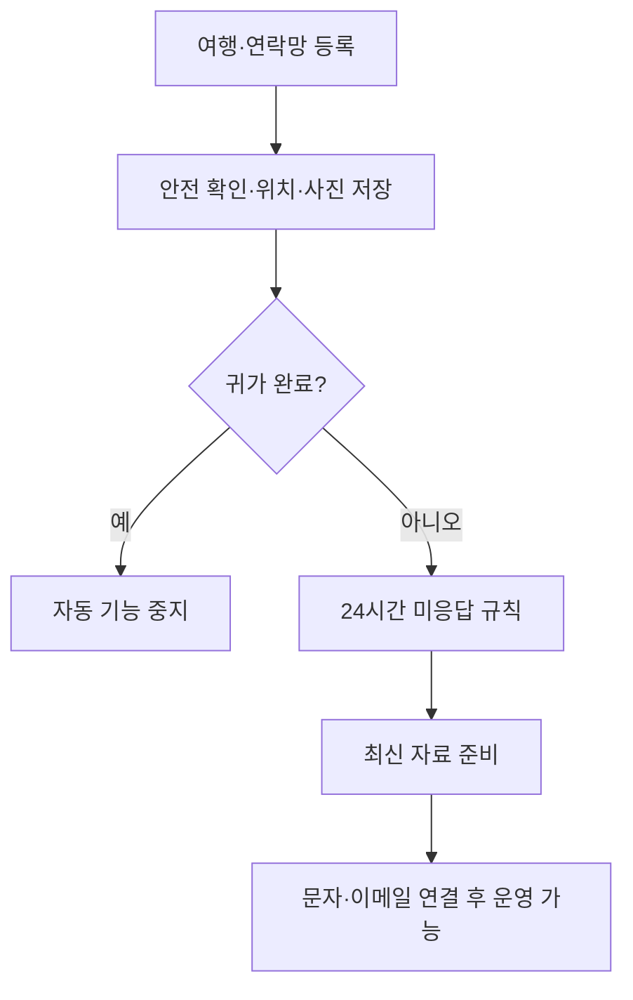

# 여행안심 V1.3 · 화면설계

작성 기준: 2026-10-20, 실제 V1.3 소스. 미구현·미검증은 별도 표시합니다.

## 3. 화면구성도

| 화면 | 주요 요소 | 완료 후 이동 |
|---|---|---|
| 홈 | 여행 카드, 안전 확인, 현재 위치, 마지막/다음 위치 저장, 24시간 기준, 최근 기록 | 홈 유지 |
| 여행 일정 | 이름·연락처·기간·숙소·교통·계획 경로·기관 번호 | 등록/수정 저장 후 홈 |
| 연락망 | 이름·전화·이메일 필수 입력, 관계, 동의, 수정·삭제·직접 연락 | 저장 후 홈 |
| 신고자료 | 사진 선택/촬영 즉시 업로드, 최신정보·위치·사진 시각, 텍스트·인쇄/PDF | 해당 화면 |
| 팝업 | 여행 등록, 연락처, 안전 확인, SOS, 귀가 완료, QR, 도움말 | 처리 후 홈 또는 연락망 |

휴대전화 하단 메뉴: 홈 / 여행 일정 / 연락망 / 신고자료. SOS는 기록 후 직접 연락할 수 있는 연락망 화면으로 이동합니다. 사진이 포함된 수동 전달은 인쇄/PDF 저장 후 파일 공유를 사용합니다. 일반 공유 버튼은 텍스트만 전달합니다.

