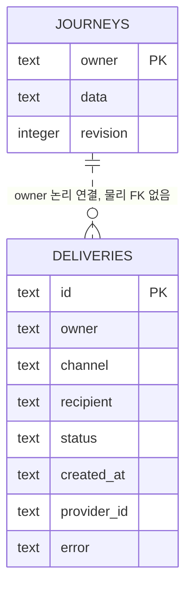

# 여행안심 V1.3 · DB_ERD

작성 기준: 2026-10-20, 실제 V1.3 소스. 미구현·미검증은 별도 표시합니다.

## 4. DB 설계와 ERD

실제 DB는 SQLite 호환 Cloudflare D1입니다. MySQL·PostgreSQL·FastAPI로 이관한 버전이 아닙니다.

| 테이블 | 컬럼·타입 | 키·제약 | 용도 |
|---|---|---|---|
| journeys | owner TEXT | PK, NOT NULL | 외부 인증에서 받은 사이트별 사용자 ID |
| journeys | data TEXT | NOT NULL | 여행·연락처·위치·상태를 JSON으로 저장 |
| journeys | revision INTEGER | NOT NULL, 기본 0 | 동시 저장 충돌 감지 |
| deliveries | id TEXT | PK, NOT NULL | 계정·안전확인시각·채널·수신자 해시 중복 방지 |
| deliveries | owner TEXT | NOT NULL, 물리 FK 없음 | 계정별 발송 기록 조회 |
| deliveries | channel, recipient, status TEXT | NOT NULL | 문자/이메일, 수신자, 요청 상태 |
| deliveries | created_at TEXT | NOT NULL | 기록 생성시각 |
| deliveries | provider_id, error TEXT | NULL 가능 | 업체 요청 ID, 오류 안내 |

`data` 내부 항목: `trip`, `contacts[]`, `events[]`, `location`, `status`, `lastCheck`, `lastAutoLocationAt`, `alertsEnabled`, `dataUpdatedAt`. 연락처 배열의 `id`는 논리 식별자이며 SQL의 PK/FK가 아닙니다. 이름·전화·이메일·동의·중복은 서버에서 검사합니다. 현 스키마에 물리 FK·JSON 내부 NOT NULL·CHECK가 있다고 표현하지 않습니다.

사진은 R2에 `photos/{사용자ID의 SHA-256}/{person|area}` 형태로 저장하며 최신 파일로 교체합니다. 사진은 별도 SQL 테이블이 아닙니다. 현재 위치도 최신 한 건이며 좌표 이력을 계속 축적하는 테이블은 없습니다.

실제 스키마: `db/schema.ts`, `drizzle/0000_thick_young_avengers.sql`, `drizzle/0001_wakeful_black_cat.sql`.

## V1.4 추가: AI 요청 횟수 제한

운영 V1.3의 두 테이블에 더하여 소스 V1.4에는 `ai_usage`가 추가되었습니다. 배포 전 마이그레이션은 `drizzle/0002_ai_usage.sql`입니다.

| 컬럼 | 타입 | 제약 | 목적 |
|---|---|---|---|
| owner | TEXT | PK, NOT NULL | 인증된 계정 식별자 |
| day | TEXT | NOT NULL | UTC 날짜 |
| count | INTEGER | NOT NULL | 당일 요청 수 |
| last_at | INTEGER | NOT NULL | 마지막 요청 시각(ms) |

`journeys.owner`와 논리적으로 연결되며 물리 FK는 없습니다. 원문·생성 결과·API 키는 저장하지 않습니다. 사용자 자료 전체 삭제와 별개로 요청 제한 기록은 유지됩니다. 1분 1회·하루 20회 제한은 원자적 SQL에서 적용합니다.
